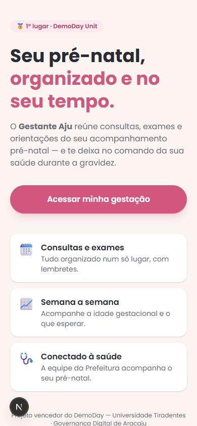
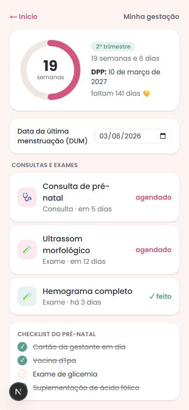

<div align="center">

# 🤰 Gestante Aju

**App de acompanhamento pré-natal para gestantes atendidas pela Prefeitura de Aracaju**
*Prenatal-care companion app for expectant mothers served by the city of Aracaju*


[**Português**](#-português) · [**English**](#-english)

</div>

> 🏆 **1º lugar no DemoDay da Universidade Tiradentes (Unit)** — desafio *“Governança Digital da
> Prefeitura de Aracaju”*, entre **36 equipes**. Este repositório leva o protótipo premiado a um
> **app funcional**. · [📰 Matéria da Unit](https://portal.unit.br/blog/noticias/demo-day-desafia-calouros-de-ti-a-criarem-solucoes-para-a-governanca-digital-de-aracaju/)

<div align="center">


&nbsp;&nbsp;


<sub>📷 Telas atuais · _adicione aqui o link do deploy (Vercel) quando publicar._</sub>

</div>

---

## 🇧🇷 Português

### Sobre

Aplicativo **mobile-first** que descomplica o pré-natal: reúne consultas, exames e orientações num
só lugar e coloca a gestante no comando da própria saúde — enquanto a equipe de saúde da Prefeitura
acompanha quem precisa de atenção. Duas plataformas: **app da gestante** e **painel do gestor**.

### Funcionalidades

- 📈 **Idade gestacional** calculada a partir da DUM (semanas/dias, trimestre, DPP, dias restantes)
- 🗓️ **Consultas e exames** do pré-natal e **checklist** de acompanhamento
- 🔐 **Papéis `gestante`/`gestor`** com **Row-Level Security** no banco (cada gestante só vê o seu)
- 📱 **PWA** instalável, design acolhedor e mobile-first
- ✅ **Teste automatizado** da regra gestacional + **CI** (lint, types, testes, build)

### Stack

**Next.js 16 (App Router)** · **React 19** · **TypeScript** · **Tailwind CSS v4** · **Supabase**
(Auth + PostgreSQL com **RLS**) · **Zod** · **Vitest** · **GitHub Actions**.

### Como rodar

```bash
npm install
cp .env.example .env.local     # preencha com o seu projeto Supabase
# rode supabase/schema.sql no SQL Editor do Supabase (cria tabelas + RLS)
npm run dev                    # http://localhost:3000
```

Outros scripts: `npm test` · `npm run typecheck` · `npm run lint` · `npm run build`.

### Roadmap

- [x] Idade gestacional (regra + testes) e painel da gestante
- [x] **Autenticação (Supabase Auth)** — login/cadastro, sessão via `proxy.ts`
- [x] **Persistência com RLS** — DUM e consultas/exames salvos por gestante (Server Actions)
- [ ] Painel do gestor (lista de gestantes + sinalização)
- [ ] Notificações/lembretes e conteúdo educativo por trimestre

### Autenticação & dados

Login com e-mail/senha (Supabase Auth). Ao cadastrar, um `profile` é criado por
trigger. A DUM e os eventos (consultas/exames) são gravados com **Server Actions** e
protegidos por **RLS**: cada gestante só acessa os próprios dados; o papel `gestor`
tem leitura das pacientes. Para um teste rápido, desative a confirmação de e-mail em
*Supabase → Authentication → Providers → Email*.

---

## 🇺🇸 English

### About

A **mobile-first** app that simplifies prenatal care: it brings appointments, exams and guidance
together and puts the mother in charge of her own health — while the city's health team follows up
on who needs attention. Two platforms: a **patient app** and a **manager dashboard**.

### Features

- 📈 **Gestational age** computed from the LMP (weeks/days, trimester, due date, days left)
- 🗓️ Prenatal **appointments & exams** and a follow-up **checklist**
- 🔐 **`patient`/`manager` roles** with database **Row-Level Security** (each patient sees only her own data)
- 📱 Installable **PWA**, warm mobile-first design
- ✅ **Automated test** for the gestational rule + **CI** (lint, types, tests, build)

### Stack

**Next.js 16 (App Router)** · **React 19** · **TypeScript** · **Tailwind CSS v4** · **Supabase**
(Auth + PostgreSQL with **RLS**) · **Zod** · **Vitest** · **GitHub Actions**.

### Getting started

```bash
npm install
cp .env.example .env.local     # fill in your Supabase project
# run supabase/schema.sql in the Supabase SQL Editor (tables + RLS)
npm run dev                    # http://localhost:3000
```

---

<div align="center">

🥇 DemoDay Unit · Desenvolvido por **[@teuzslima](https://github.com/teuzslima)** e equipe

</div>
